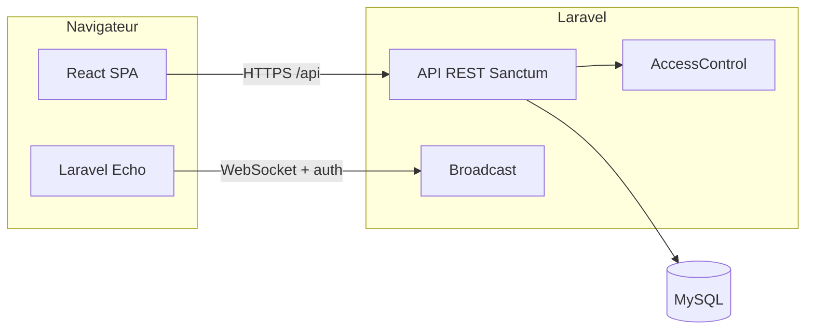

# Documentation détaillée — Gestion des Projets (PFE)

Ce document décrit l’application **de bout en bout** : objectifs, architecture, données, sécurité, API REST, interface React, temps réel, IA et jeux de données de test.

---

## 1. Vue d’ensemble

### 1.1 Objectif

Application web de **gestion de projets** pour équipes : projets rattachés à des équipes, tâches avec statuts Kanban par projet, planning (calendrier, Gantt), suivi du temps, commentaires et pièces jointes, notifications, fil d’activité, et **services d’aide à la décision** (estimation, risque de retard, suggestions d’affectation).

### 1.2 Inspiration et périmètre

Le produit s’inspire d’outils type monday.com / Trello / Gouti. Le dépôt est découpé en deux parties :

| Dossier   | Rôle |
|-----------|------|
| `laravel/` | API REST, authentification, règles métier, persistance MySQL |
| `react/`   | Interface utilisateur (SPA) servie par Vite |

### 1.3 Version API

L’API expose une route racine `GET /api/` qui renvoie notamment `app: "Gestion Projets PFE"` et `version: "1.0.0"`.

---

## 2. Stack technique

### 2.1 Backend

- **PHP** ≥ 8.2, **Laravel** 12
- **Laravel Sanctum** : jetons API (Bearer) pour la SPA
- **Spatie Laravel Permission** : rôles globaux (`admin`, `member`, `viewer`) et permissions nommées
- **MySQL** 8+ (schéma avec migrations)
- **Broadcasting** : compatible **Laravel Reverb** ou **Pusher** (protocole Pusher côté client via `laravel-echo` + `pusher-js`)

### 2.2 Frontend

- **React** 19, **Vite**, **React Router**
- **TanStack React Query** : cache et requêtes HTTP
- **Tailwind CSS** (plugin Vite)
- **Sonner** : toasts
- **Lucide React** : icônes

### 2.3 Proxy de développement

Le serveur Vite (`react/vite.config.js`) proxy `/api` vers `http://localhost:8000` (Laravel `php artisan serve`). Le frontend appelle donc des URLs relatives `/api/...`.

### 2.4 IA (côté serveur)

Logique métier en **PHP** (estimation type PERT, scores de risque, recommandations d’affectation), exposée sous le préfixe `/api/ai/...`. Aucun appel obligatoire à un fournisseur externe pour ces endpoints (selon l’implémentation du service applicatif).

---

## 3. Architecture logique



1. L’utilisateur s’authentifie ; Sanctum renvoie un **token** stocké côté client (souvent `localStorage`).
2. Chaque requête API authentifiée envoie `Authorization: Bearer <token>`.
3. Les **policies** et la classe **`App\Support\AccessControl`** déterminent l’accès aux projets et aux tâches.
4. Le **temps réel** (si clés Reverb/Pusher configurées) permet d’écouter des canaux privés ; sinon Echo bascule en mode no-op.

---

## 4. Modèle de données (résumé)

Principaux modèles Eloquent (`laravel/app/Models/`) :

| Modèle | Rôle |
|--------|------|
| **User** | Compte, timezone, rôles Spatie |
| **Team** | Équipe ; membres via table pivot `team_user` (rôle dans l’équipe, capacité h/semaine, compétences JSON, actif) |
| **Project** | Projet (code unique, statut, dates, budget/coûts optionnels, `team_id`, `owner_id`, soft delete) |
| **project_members** | Ancienne pivot « membre projet » (`project_role`) — toujours utilisée par les seeders et une partie du code |
| **project_user** | Pivot plus récente : rôle projet `admin` / `member` / `viewer` ; **AccessControl** la privilégie si la ligne existe |
| **Client** | Client métier rattachable aux projets |
| **Task** | Tâche (projet, statut Kanban, priorités, dates planifiées, heures, progression, workflow, etc.) |
| **TaskStatus** | Colonnes Kanban **par projet** (nom, couleur, ordre, défaut) |
| **Sprint** | Sprints / backlog par projet |
| **TaskDependency** | Dépendances entre tâches (ex. fin → début) |
| **TaskComment**, **Attachment**, **TimeEntry** | Collaboration et suivi du temps |
| **TaskAssignment** | Affectation avec pourcentage d’allocation |
| **Notification** | Notifications in-app |
| **Activity** / **ActivityLog** | Activité / journalisation pour le fil d’activité |
| **ProjectInvitation** | Invitations projet |
| **AiRecommendation** | Stockage ou trace de recommandations IA (selon usage) |

Les migrations dans `laravel/database/migrations/` font foi pour les colonnes exactes.

---

## 5. Rôles, permissions et accès

### 5.1 Rôles globaux (Spatie)

Définis dans `RoleAndPermissionSeeder` :

- **admin** : toutes les permissions listées (utilisateurs, équipes, projets, tâches, rapports, IA, etc.).
- **member** : consultation projets, gestion des tâches (selon contexte projet), temps, rapports, IA.
- **viewer** : consultation limitée (`view-projects`, `view-tasks`, `view-reports`) — **pas** de modification des tâches via les règles `AccessControl`.

### 5.2 Rôle sur un projet

`AccessControl::projectRole()` fusionne :

1. La table **`project_user`** si présente (rôles `admin`, `member`, `viewer` ; `viewer` peut être normalisé en `guest` pour certaines branches).
2. Sinon la pivot **`project_members.project_role`** mappée vers des rôles logiques (`owner`/`manager` → admin, etc.).

### 5.3 Règles métier importantes

- **Voir un projet** (`canViewProject`) : admin ; ou membre explicite / owner ; ou (pour un non-viewer) utilisateur assigné à au moins une tâche du projet ; les **viewer** sans lien projet n’ont pas accès par défaut.
- **Modifier un projet** (`canEditProject`) : admin, owner, ou rôle projet **admin** — pas les **viewer** globaux.
- **Créer / déplacer des tâches** (`canCreateTaskInProject`) : pas les viewer globaux ni les « guest » projet.
- **Modifier une tâche** (`canEditTask`) : admin ; owner ou admin projet ; créateur de la tâche ; ou assigné — pas viewer / guest / viewer projet.
- **Supprimer une tâche** : **admin** uniquement (`canDeleteTask`).

### 5.4 Middleware HTTP

- **`auth:sanctum`** : routes protégées.
- **`check.role:admin`** : réservé admin (ex. `GET /api/admin/dashboard`, CRUD `users` hors `show`).
- **`check.project:view` / `check.project:edit`** : vérifie l’accès au **projet** de la route (`CheckProjectAccess`).

Les policies Laravel (`TaskPolicy`, `ProjectPolicy`, etc.) complètent Sanctum pour certaines actions (ex. `can:update,task`).

---

## 6. API REST (routes principales)

Toutes les routes ci-dessous sont préfixées par **`/api`** (fichier `laravel/routes/api.php`).

### 6.1 Publiques

| Méthode | Chemin | Description |
|---------|--------|---------------|
| GET | `/` | Infos application / version |
| POST | `/auth/register` | Inscription |
| POST | `/auth/login` | Connexion (retour token) |
| GET | `/invitations/verify` | Vérification invitation |
| GET | `/invites/{token}` | Détail invitation par jeton |

### 6.2 Authentifiées (Sanctum)

**Auth & profil**

- `POST /auth/logout`, `GET /me`
- Invitations : pending, accept, decline ; création d’invites (`invites`)

**Tableaux de bord & activité**

- `GET /member/dashboard`, `GET /member/dashboard/summary`
- `GET /activity/feed`
- `GET /admin/dashboard` (**admin**)

**Équipes**

- `apiResource teams` (CRUD)
- `POST teams/{team}/members`, `DELETE teams/{team}/members/{user}`

**Utilisateurs (admin)**

- `apiResource users` sauf `show` (gestion des comptes)

**Clients & projets**

- `apiResource clients`, `apiResource projects`
- Sous-projet (avec middleware projet) : `dashboard`, `activity`, `members`, `critical-path`, `invite`, `user-search`, ajout/retrait membres, `recalculate-costs`

**Sprints & backlog**

- Liste sprints, backlog ; création sprint ; start/end ; assignation tâche ↔ sprint

**Statuts Kanban**

- `GET/POST projects/{project}/statuses`, `reorder`
- `PUT/DELETE statuses/{status}`

**Tâches**

- `GET /tasks` : vue globale des tâches (hub)
- `GET/POST projects/{project}/tasks`
- `GET/PUT/DELETE tasks/{task}`, `PATCH tasks/{task}/move`
- Assignation, dépendances, commentaires, pièces jointes, entrées de temps (sous-routes `tasks/{task}/...`)

**Vues transverses**

- `GET /calendar`
- `GET /gantt` (Gantt global)
- `GET projects/{project}/gantt`, `PUT projects/{project}/gantt` (mise à jour dates)

**Notifications**

- Liste, résumé, marquer lu / tout lu

**IA** (`/api/ai/...`)

- Estimation tâche, risque retard (tâche / projet), suggestion d’affectation, optimisation affectations projet, recommandations projet

**Broadcasting**

- `Broadcast::routes` sous `auth:sanctum` pour l’auth des canaux privés.

---

## 7. Interface React (routes)

Fichier `react/src/App.jsx` :

| Chemin | Page | Accès |
|--------|------|--------|
| `/` | Landing | Invité (non connecté) |
| `/login`, `/register` | Auth | Invité |
| `/accept-invite` | Acceptation invitation | Public / selon flux |
| `/dashboard` | Tableau de bord membre | Connecté |
| `/projects`, `/projects/:id` | Liste / détail projet (Kanban, etc.) | Connecté |
| `/tasks` | Hub toutes tâches | Connecté |
| `/calendar` | Calendrier | Connecté |
| `/teams`, `/teams/:id` | Équipes | **admin** |
| `/users` | Administration utilisateurs | **admin** |
| `/gantt` | Gantt | **admin**, **member** |
| `/ai` | Outils IA | **admin**, **member** |
| `/notifications` | Centre de notifications | Connecté |
| `/settings` | Paramètres | **admin** |

Les gardes sont dans `react/src/routes/guards.jsx` (`ProtectedRoute`, `GuestRoute`, `RoleRoute`).

---

## 8. Temps réel (Echo)

- Fichier `react/src/lib/echo.js` : instancie **Laravel Echo** avec **Pusher** sous-jacent.
- Variable **`VITE_BROADCAST_DRIVER`** : `reverb` (par défaut) ou autre ; clés **`VITE_REVERB_*`** ou **`VITE_PUSHER_*`**.
- Si aucune clé n’est définie, Echo utilise un **stub** (pas de WebSocket) pour éviter les erreurs en développement.

---

## 9. Seeders et comptes de démonstration

### 9.1 Ordre d’exécution

`DatabaseSeeder` appelle :

1. `RoleAndPermissionSeeder`
2. `DemoDataSeeder`
3. `TestDataSeeder`

### 9.2 DemoDataSeeder

Crée l’admin, des membres, l’équipe « Équipe Développement », les projets **GPFE** et **SITE**, colonnes Kanban, nombreuses tâches, dépendances, commentaires, temps passé.

### 9.3 TestDataSeeder

Données **supplémentaires** idempotentes (`firstOrCreate`) :

- Utilisateurs : `leila.test@...`, `karim.test@...` (member), `observer.test@...` (viewer) — mot de passe **`password`**
- Équipes : « Équipe Mobile (test) », « Équipe QA (test) »
- Projets codes **MOBAPP**, **QACAMP** avec tâches

**Important** : `TestDataSeeder` exige que l’admin démo `admin@gestion-projets.local` existe (donc lancer `DemoDataSeeder` avant, ou un `php artisan db:seed` complet).

### 9.4 Comptes démo classiques (DemoDataSeeder)

| Rôle | Email | Mot de passe |
|------|--------|--------------|
| Admin | admin@gestion-projets.local | password |
| Autres | manager@, dev1@, dev2@, dev3@ @gestion-projets.local | password |

---

## 10. Installation et commandes utiles

### 10.1 Base de données

Créer une base MySQL (ex. `gestion_projets_pfe`, utf8mb4).

### 10.2 Laravel

```bash
cd laravel
composer install
cp .env.example .env
php artisan key:generate
# Configurer DB_* dans .env
php artisan migrate
php artisan db:seed
php artisan serve --port=8000
```

### 10.3 React

```bash
cd react
npm install
npm run dev
```

Application front : en général **http://localhost:5173** ; API : **http://localhost:8000**.

### 10.4 Commandes ciblées

```bash
php artisan db:seed --class=DemoDataSeeder
php artisan db:seed --class=TestDataSeeder
```

---

## 11. Fichiers et dossiers utiles (référence rapide)

| Emplacement | Contenu |
|-------------|---------|
| `laravel/routes/api.php` | Déclaration des routes API |
| `laravel/app/Support/AccessControl.php` | Centralisation des règles d’accès projet/tâche |
| `laravel/app/Policies/` | Policies Eloquent |
| `laravel/database/seeders/` | Jeux de données |
| `react/src/App.jsx` | Routage SPA |
| `react/src/contexts/AuthContext.jsx` | Session / token |
| `react/vite.config.js` | Proxy `/api` |

---

## 12. Périmètre non exhaustif

L’application peut évoluer (nouvelles migrations, champs API, pages React). En cas d’écart entre ce document et le code, **le code et les migrations font autorité**. Pour une liste exhaustive des endpoints, ouvrir `laravel/routes/api.php` ; pour les écrans, parcourir `react/src/pages/`.

---

*Document généré pour le dépôt « Gestion des Projets PFE » — à maintenir lors des évolutions majeures du produit.*
